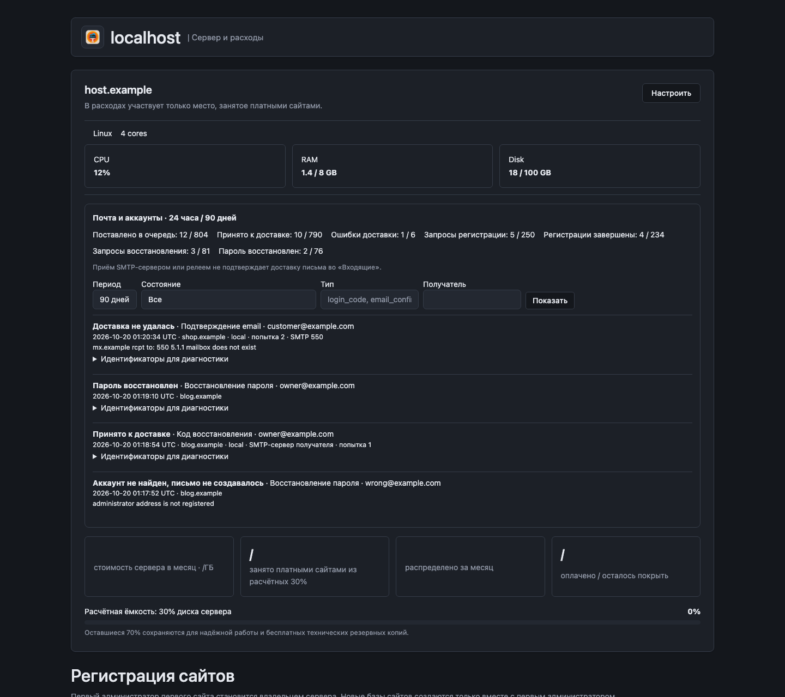

# Mail and account monitoring

Open **Hosting and support → server metrics → Mail and accounts** as a server administrator. Select a server and open **Mail journal** to see recipients, sites, message types, attempts, SMTP error codes and bounded error details. Filters support 1, 7, 30 or 90 days, exact type/stage and recipient substring; the journal has 50 events per page. The paginator shows the filtered event count and current/total pages, with numbered links, first/last navigation and a page-number input. Page links and jumps preserve the selected server and filters; out-of-range pages select the nearest available page.

## Reading the counters

Counters show events during the last 24 hours and 90 days. Queued means messages added during that period, not the current queue length. SMTP acceptance, registration completion and password recovery completion are separate events. Requests and completions in a time window are not necessarily the same cohort.

| Stage | Meaning |
| --- | --- |
| Queued | The durable outbox and its journal event were committed together. |
| Delivery attempt / retry | The transport is working on the message or has scheduled another attempt. |
| Accepted for delivery | The recipient SMTP server or central relay accepted the message. This does **not** prove inbox placement, reading or eventual delivery. |
| Delivery failed | The transport reported a permanent failure or the delivery deadline expired. |
| Registration requested / email confirmed | A signup started or its email link/code was confirmed. The account may still be waiting for HTTPS, password setup or administrator approval. |
| Registration completed | Account creation succeeded. |
| Recovery requested / password recovered | A recovery request was saved / the password was actually changed. |
| Account not found | No matching administrator account existed, so no recovery email was created. |

For diagnostics, expand the message/request identifiers. A request identifier is a one-way hash, not a reusable confirmation token. The journal stores no email body, password, confirmation code or action URL. Reflected URLs, opaque tokens and codes are redacted from error details; diagnostic text is limited to 500 bytes. Access uses the existing server-manager permission gate. Journal pages are not cached.

## Transport diagnostics

The main journal shows `Queued`, then the delivery transport and SMTP server, followed by `Accepted`, `Temporary failure` or `Rejected`. A successful relay operation is shown as `Sent`; it is not presented as a recipient SMTP response. Each server records its own part of delivery, so the central relay's SMTP result appears under that server.

NetChan remains unchanged. The SiteBrush transport adapter observes the existing authenticated connection and displays `netchan(quic:4433)` or `netchan(tcp:9000)` using the actual remote socket port. A known transport without a known port omits the port. Unobserved transports and ambiguous reconnects display only `netchan`. No port is inferred from configuration or defaults. Existing HTTPS adapters report their connected port when available, adding `(fallback)` only when that adapter was used as a fallback. This change does not introduce a new mail delivery fallback policy.

SMTP reports the host used for the connection and the port from its actual remote socket. The status code comes from the final DATA response on success or the failing SMTP command on rejection. Short recognized responses are normalized to safe summaries such as `OK`, `User unknown` and `Try again later`; unrecognized responses retain their numerical code and a generic summary. Arbitrary SMTP prose is never stored because a peer could reflect codes, passwords, links or message content. Acceptance still does not establish inbox placement.

Redundant attempt and received-transport events are omitted from the default journal before pagination. Message/request identifiers, attempts, routes and library versions remain in **Diagnostic identifiers**. Historical records with no SMTP connection details do not acquire guessed hosts, ports or replies.

## Remote servers and retention

Each installation records its own delivery work. On a central relay, its SMTP attempts appear under the central server; the originating server records its relay attempts. Their message identifiers can be compared without adding both servers' counts together as unique customer messages.

Events are synchronized in signed batches over the existing NetChan transport, with the existing encrypted HTTPS adapter as fallback. Each batch contains at most 80 events and must fit the encoded byte budget, including JSON escaping, signatures and the HTTPS encryption/base64 envelope. Large batches are split and synchronization continues until every acknowledged prefix is drained. The receiver checks the registered installation key, refuses blocked installations and reserves the local journal namespace. It commits each batch before acknowledging it. Replayed batches cannot increase counters. A failed or missing acknowledgment leaves the sender's events pending for a later report. Older central versions reject the dedicated synchronization request and do not falsely acknowledge it.

The remote view shows when the last batch arrived, including an empty heartbeat. A server with no monitoring heartbeat is shown as unavailable, not as a verified zero. Data can lag until the next report; update both the originating server and the central installation to enable remote monitoring.

The detailed journal covers 90 days. Old records are removed at process startup and by daily maintenance. History starts when this version is installed; old log lines are not reconstructed into account outcomes. Bounce/DSN processing and inbox-delivery confirmation are outside this feature.

## Interface preview

Rendered from the actual expenses template using synthetic addresses and metrics. The screenshot demonstrates layout; it does not represent live mail delivery.

## Account email abuse protection

Registration, password recovery and site registration requests require a one-use, six-character PNG CAPTCHA. Its random answer is stored only as a salted hash in the server control database; the browser receives an opaque HttpOnly nonce. A challenge is bound to its source IP, domain and form purpose, lasts five minutes, requires at least two seconds before submission and is consumed even on a wrong answer. Image issuance is limited to six per IP per minute, with at most 10,000 live challenges. New-domain registration remains available before HTTPS without creating a site database or transmitting a password.

The server applies these limits across all sites and both registration/recovery forms:

| Boundary | Limit |
| --- | --- |
| Source IP requests, including invalid CAPTCHA attempts | 8/minute, 20/hour, 40/day |
| Different recipient addresses requested by one IP | 3/hour, 5/day; the next distinct address triggers a block |
| Different recipients inside one minute | 3; the next distinct address triggers a block |
| Network requests | 100/hour per IPv4 /24 or IPv6 /64 |
| CAPTCHA-approved requests to one recipient across all source IPs | 60-second cooldown, 3/hour, 6/day |

A source violation blocks account email requests from that IP for one hour, or 24 hours for a daily violation. It does not lock the victim's account or disable ordinary website visits. Blocks survive restarts. Recipient delivery quotas are charged only after a valid CAPTCHA, so simply naming a victim in an unsolved request cannot exhaust that recipient's allowance. The request ledger is retained for 24 hours and capped at 20,000 rows; reaching capacity fails closed for new account email requests.

The mail journal shows the initiating IP when known. Follow-up outbox events inherit it from the queued event, including after restart. Historical rows do not acquire inferred IPs. Under the local server's **Diagnostic identifiers**, administrators can block account email requests from an IP for 24 hours; **Blocked email request IPs** provides an unblock action. Delivery workers recheck source blocks before sending queued messages. An already accepted SMTP message cannot be withdrawn.

IP attribution uses the account subsystem's trusted proxy chain. Configure `SITEBRUSH_TRUSTED_PROXIES` for an actual reverse proxy; direct clients cannot select their identity with forwarded headers. Requests with unavailable client identity fail closed. Remote server journals retain their originating IPs in the existing signed diagnostic synchronization; blocking controls apply on the server that owns the requests.

A raster CAPTCHA is a barrier against trivial parsing and guessing, not a guarantee against OCR, browser automation or human solving services. Independent IP, network and recipient limits remain mandatory.
